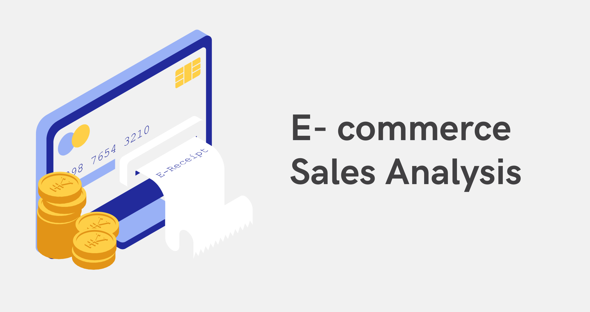

# UNIGAP - PORTFOLIO BUILDING MODULE -  PBI TEMPLATE

🔥Use this template as an outline for your Github projects. Make a copy of this readme file and tailor it your own. Happy portfolio-ing and start applying aggressively :"))

---

Change Icon emoji 🔥🔍📘🚩 to your likings by clicking "Start" + "."

# 📊 Project Title: [Your Project Name]  
Author: [Your Name]  
Date: YYYY-MM-DD  
Tools Used: SQL/ Power BI/ Python  

---

## 📑 Table of Contents  
1. [📌 Background & Overview](#-background--overview)  
2. [📂 Dataset Description & Data Structure](#-dataset-description--data-structure)  
3. [🧠 Design Thinking Process](#-design-thinking-process)  
4. [📊 Key Insights & Visualizations](#-key-insights--visualizations)  
5. [🔎 Final Conclusion & Recommendations](#-final-conclusion--recommendations)

---

## 📌 Background & Overview  

### Objective:
### 📖 What is this project about? 
 
- Provide a brief introduction to the project. Define the problem statement/ business question that this project will show and why it is important.
- Write in bullet point format

 _Example:_

 This project analyzes sales trends and inventory control using SQL and Power BI. The objective is
✔️ Identify high-demand products and sales trends.  
✔️ Optimize inventory levels to prevent overstocking or stockouts.  
✔️ Provide actionable insights through Power BI dashboards.  

### 👤 Who is this project for?  

Mention who might benefit from this project 

 _Example:_

✔️ Data analysts & business analysts  
✔️ Supply chain managers & inventory controllers  
✔️ Decision-makers & stakeholders  

---

## 📂 Dataset Description & Data Structure  

### 📌 Data Source  
- Source: (Mention where the dataset is obtained from—Kaggle, company database, government sources, etc.)  
- Size: (Mention the number of rows & columns)  
- Format: (.csv, .sql, .xlsx, etc.)  

### 📊 Data Structure & Relationships  

#### 1️⃣ Tables Used:  
Mention how many tables are in the dataset.  

#### 2️⃣ Table Schema & Data Snapshot  

Table 1: Products Table  

👉🏻 Insert a screenshot of table schema. if table is too long, only show a snapshot of it. Recommend to put it in a toggle format

 _Example:_

| Column Name | Data Type | Description |  
|-------------|----------|-------------|  
| Product_ID  | INT      | Unique identifier for each product |  
| Name        | TEXT     | Product name |  
| Category    | TEXT     | Product category |  
| Price       | FLOAT    | Price per unit |  

Table 2: Sales Transactions  

👉🏻 Insert a screenshot of table schema. if table is too long, only show a snapshot of it. Recommend to put it in a toggle format

 _Example:_

| Column Name    | Data Type | Description |  
|---------------|----------|-------------|  
| Transaction_ID | INT      | Unique identifier for each sale |  
| Product_ID     | INT      | Foreign key linking to Products table |  
| Quantity       | INT      | Number of items sold |  
| Sale_Date      | DATE     | Date of transaction |  

📌If the table is too big, only capture a part of it that contains key metrics you used in the projects or put the table in toggle

Click to toggle

This content is hidden by default and will expand/collapse when clicked.

You can add more details here, like code blocks, lists, or images.

#### 3️⃣ Data Relationships:  
Describe the connections between tables—e.g., one-to-many, many-to-many.  

👉🏻 Include a screenshot of Data Modeling to visualize relationships.  

---

## 🧠 Design Thinking Process  

Explain the step-by-step approach taken to solve the problem.  

👉🏻 Insert a screenshot of the Design Thinking steps (Screenshot your Excel design thinking tables for better presentation).  

1️⃣ Empathize  
2️⃣ Define point of view  
3️⃣ Ideate  
4️⃣ Prototype and review  

---

## ⚒️ Main Process

1️⃣ Data Cleaning & Preprocessing 
2️⃣ Exploratory Data Analysis (EDA)  
3️⃣ SQL/ Python Analysis 

- In each step, show your Code

- Include query/ code execution screenshots or result samples

- Explain its purpose and its findings

4️⃣ Power BI Visualization  (applicable for PBI Projects)

---

## 📊 Key Insights & Visualizations  

### 🔍 Dashboard Preview  

#### 1️⃣ Dashboard 1 Preview  
👉🏻 Insert Power BI dashboard screenshots here  

📌 Analysis 1:  
- Observation: _Describe trends, key metrics, and patterns. Any insights from those observation_  
- Recommendation: _Suggest actions based on insights._  

#### 2️⃣ Dashboard 2 Preview  
👉🏻 Insert Power BI dashboard screenshots here

📌 Analysis 2:   
- Observation: _Describe trends, key metrics, and patterns. Any insights from those observation_  
- Recommendation: _Suggest actions based on insights._  

#### 3️⃣ Dashboard 3 Preview  
👉🏻 Insert Power BI dashboard screenshots here  

📌 Analysis 3:  
- Observation: _Describe trends, key metrics, and patterns. Any insights from those observation_  
- Recommendation: _Suggest actions based on insights._  

---

## 🔎 Final Conclusion & Recommendations  

👉🏻 Based on the insights and findings above, we would recommend the [stakeholder team] to consider the following:  

📌 Key Takeaways:  
✔️ Recommendation 1  
✔️ Recommendation 2  
✔️ Recommendation 3
